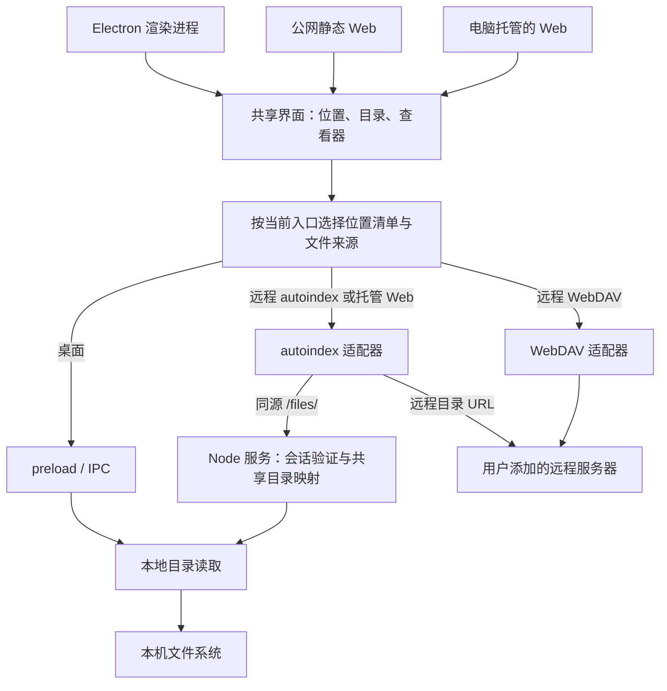

# View 第一版设计

View 是一个以文件夹为入口的只读文件查看器。用户可以在电脑上打开本地目录，在网页上浏览 HTTP autoindex 或 WebDAV，也可以在 iPad 上打开电脑提供的 Web App。目录浏览以 Explorer 为参考，媒体查看以 XnView MP 为参考。

## 三个入口，一个位置首页

首页要回答“我现在可以从哪里开始看”。点进任何位置后，都进入同一套目录和预览界面。

| 入口 | 首页展示什么 | 用户可以做什么 | 谁保存这些位置 |
| --- | --- | --- | --- |
| Electron 桌面 | 已收藏的本地目录 | 打开任意可读文件夹，在当前目录收藏或开启 HTTP 共享，管理共享服务 | 桌面应用在本机保存收藏和共享配置 |
| 公网静态 Web | 用户添加的 autoindex / WebDAV 地址 | 添加地址、浏览、移除位置 | 当前浏览器保存位置名称、协议和地址 |
| 电脑托管的 Web | 这台电脑上所有已开启 HTTP 共享的目录 | 输入密钥后浏览全部共享位置，点进任意一个 | 桌面服务提供清单，所有已授权浏览器看到同一组位置 |

### 在电脑上收藏和共享

打开文件夹后直接进入内容页。路径旁提供「收藏」和「HTTP 共享」两个独立操作，作用于**当前目录**。比如用户从已收藏的「照片」进入「旅行」，可以只共享「旅行」。桌面提供一个「共享管理」入口，能找到所有已共享的目录，包括从未收藏的目录，也能复制服务地址、查看二维码、停止共享服务。

收藏和共享各自按目录保存，重启应用后恢复配置。建议由用户显式启动局域网服务，停止服务保留共享清单，方便下次开启。仅打开文件夹不会自动将其加入任何一个首页。

### 在 iPad 上进入共享首页

1. 电脑显示一个服务地址，例如 `http://<电脑局域网地址>:<端口>/`。用户在 Safari 打开后看到密钥输入页。
2. 验证成功后显示「位置」，列出全部共享根目录。没有共享目录时提示“这台电脑还没有共享文件夹”。
3. 用户点进目录，面包屑从共享名称开始；回到「位置」可以切换到另一处共享。二维码作为便捷入口，可以用短时、一次性配对凭据建立同样的会话，落点也是「位置」。

## 应用结构

建议用 TypeScript、React 和 Vite 维护共享界面，Electron 提供桌面入口。静态部署和局域网服务分发同一份 Web 前端。局域网服务在启动配置里指定同源目录 `/files/`。验证密钥后，前端用 autoindex 适配器读取这个目录，将每个直接子目录显示为首页的一个位置。Folo 的 Web / Electron 构建入口可作为工程组织参考。[Folo 构建配置](https://github.com/RSSNext/Folo/blob/dev/apps/desktop/package.json)

| 模块 | 职责与接口 |
| --- | --- |
| 位置清单 | 给首页提供位置 ID、显示名和来源类型。桌面读收藏，静态 Web 读浏览器保存的地址，托管 Web 读 `/files/` 的目录链接。 |
| 文件来源 | 给定位置和目录，列出直接子项；给定文件，提供查看器可用的内容读取方式。只要求名称、标识和文件／目录类型，大小、修改时间、缩略图均可缺省。 |
| 桌面主进程 | 打开系统目录选择器，解析本地路径，保存收藏与共享，管理服务启停。渲染进程通过限定用途的 preload 接口访问这些能力。 |
| 局域网服务 | 用 Node 托管 Web App，验证会话，把桌面已共享的位置映射到只读的 `/files/` 目录树，提供 HTML 目录索引和静态文件读取。 |
| 查看器 | 接收条目、内容读取方式和当前目录顺序。图片、音视频、PDF、文本共用打开与返回流程，各自处理格式与解码。 |

例如，在 iPad 上拖动视频进度时，播放器对目录页给出的视频链接发起 Range 请求。电脑验证会话和共享范围后，静态文件服务返回相应片段。查看器只需要视频 URL。

**远程目录如何接入。** 同一个 autoindex 适配器读取 View 的 Node 目录页和 Nginx、Apache 的常见目录页，从条目链接提取名称和地址，过滤表头排序链接和“上级目录”，按目录 URL 解析相对链接。WebDAV 适配器用 `PROPFIND` 和 `Depth: 1` 列出一层内容，跳过响应中的目录自身，从 `resourcetype` 区分文件和子目录，用 `GET` 读取文件。两者返回同一种目录条目。无法解析的索引页提示“暂不支持此目录页格式”；仅在成功解析且没有子项时才显示“空文件夹”。

## 共享服务约定

Node 在 `/` 托管 Web App，在 `/files/` 提供 autoindex。桌面端维护“共享标识 → 显示名、本地目录”的映射，因此不同磁盘上的文件夹都可以出现在同一个虚拟根下。标识独立于显示名，两个叫「照片」的共享目录各有自己的链接。

| 请求 | 行为 |
| --- | --- |
| `POST /api/session` | 用访问密钥建立会话，由服务器设置 HttpOnly 会话 Cookie。常用访问地址和媒体链接中均不携带长期密钥。 |
| `GET /files/` | 按当前共享映射生成 HTML 目录索引。每个链接的文字是共享显示名，地址是以斜杠结尾的 `/files/<共享标识>/`。 |
| `GET /files/<共享标识>/…/` | 为目录生成 autoindex，列出直接子项，按路径段编码链接。目录里即使有 `index.html`，它也作为普通文件列出。 |
| `GET /files/<共享标识>/…/文件名` | 直接读取文件。静态服务支持 HTTP Range，对有效的单段范围请求返回 `206 Partial Content` 和对应的 `Content-Range`。 |

`/files/` 下的每次请求都先验证会话。访问某个共享时，服务还要按当前映射查找标识，并确认解析后的实际路径（含符号链接目标）位于该共享根内。关闭共享后，旧链接发起的新请求立即失效，首页刷新后移除该目录。受保护的响应禁用持久缓存。目录页对文件名做 HTML 转义，共享中的 HTML 等主动内容以下载或隔离预览方式提供。普通 HTTP 适用于用户信任的局域网，访问密钥提供访问控制，传输本身仍是明文。

扫码配对和手动输入密钥都建立同一种会话。服务端生成缩略图、转码等能力留到需要时扩展，并沿用相同的共享授权规则。

## 目录和预览

目录页沿用熟悉的路径导航、列表和缩略图网格。进入查看器时保留所在目录、排序、选中项和滚动位置；退出时定位到最后看到的条目。桌面支持键盘操作，iPad 提供相应的触控操作。排序选项和快捷键细节随原型打磨。

首次集成以图片、浏览器原生支持的音视频、PDF 和文本为例。目录可先按名称展示图标，可见区域再加载缩略图。缺少后缀、类型信息冲突或默认查看器打开失败时，可以按需使用 Magika 识别内容，再选择查看器。大文件保留流式读取路径；未知类型显示基本信息，单个文件预览失败不影响继续浏览。媒体解码扩展和 FFmpeg 选型留给有代表性的样片决定。[Magika JS](https://github.com/google/magika/tree/main/js)

图标建议用 Codicons 表示收藏、返回和切换视图等操作，用 Seti 的文件名和扩展名映射显示文件图标。缩略图就绪后，网格优先显示真实内容。集成时保留素材所需的署名和许可声明。[Codicons](https://github.com/microsoft/vscode-codicons) · [Seti](https://github.com/microsoft/vscode/tree/main/extensions/theme-seti)

## 第一条端到端验收

准备互不嵌套的 A–J 十个本地目录。收藏 A–E，共享 C–I。让 C 同时含子目录、照片、可在 Safari 播放的视频、PDF、文本和未知类型文件。这样一份样例就覆盖了四种状态。

| 目录 | 桌面收藏首页 | 已授权的 Web 共享首页 |
| --- | --- | --- |
| A、B | 显示 | 隐藏 |
| C、D、E | 显示 | 显示 |
| F、G、H、I | 隐藏 | 显示 |
| J | 隐藏 | 隐藏 |

1. **验证两个首页。** 重开桌面 App，首页显示 5 个收藏。开启服务，iPad 在密钥验证前直接访问 `/files/` 或已知文件链接均取不到内容。验证后，`/files/` 有 7 个目录链接，Web App 首页列出对应的 7 个位置。直接在桌面打开 J 不改变这两个数字。
2. **验证独立性。** 取消收藏 C，桌面变为 4 个，网页仍是 7 个。然后关闭 D 的共享，网页刷新后变为 6 个，D 仍是桌面收藏。通过 D 的旧目录和文件链接重新请求目录、文件或媒体片段，服务均拒绝读取。
3. **验证真实浏览。** 从 iPad 进入 C 的子目录，通过目录页中的链接打开名为 `旅行 合照.jpg` 的照片，再播放视频。检查视频文件的有效 Range 请求收到对应的部分内容，拖动进度后能继续播放。打开未知类型文件再返回，仍定位在原目录。二维码配对与手输密钥均可到达同一个共享首页。
4. **验证静态部署。** 在独立静态站点分别添加一个 autoindex 和一个 WebDAV 地址。刷新后两个位置仍可用，都能列子目录并预览文件。停止电脑的共享服务后，静态站点仍可浏览这两个独立来源。

Magika 的 `tests_data/basic` 可以补充识别测试，例如同一份 PDF 保留后缀、去掉后缀、改成图片后缀。渲染和播放用完整可读的文件验证，截短的文件头样本仅用于识别测试。[样本说明](https://github.com/google/magika/tree/main/tests_data)

建议首个开发里程碑先打通“桌面开启共享 → iPad 输入密钥 → 从 `/files/` 列出七个目录 → 打开一张真实照片”。再用同一个 autoindex 适配器浏览外部服务器，并接入 WebDAV，用同一张图片检验三种入口的浏览体验。
